# Neonweather — watchface for Pebble Time 2

Today's weather without a single word: rain and air pressure as a neon graphic behind big, chunky digits.
One glance tells you whether to grab an umbrella — and when.

Made by **Seb & Claude** (Anthropic): ideas, design and testing by Seb, code and docs by Claude.

> **Status: beta, version 0.30.0.** Tested in the emery emulator, with a pixel-exact preview on the Mac and Node tests —
> not yet proven in daily use. Version numbers start with 0 until it has.

<p>
  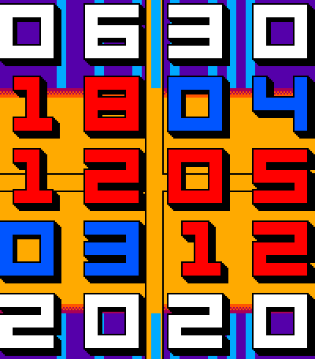
  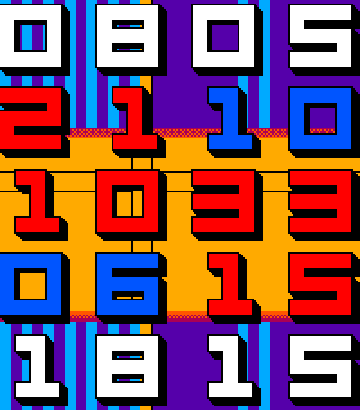
  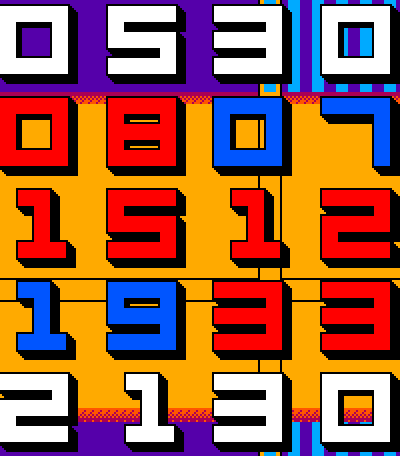
  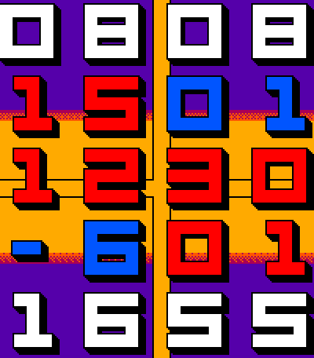
</p>

*Meet **Retro**, Seb's own look and the newest stock preset: April showers at noon · after a rainy morning ·
33 °C and a thunderstorm at four · a frosty −6 to 1 °C. All pictures: real watch code, made-up weather.*

## Contents

- [How to read it](#how-to-read-it)
- [Any weather](#any-weather)
- [Stock presets](#stock-presets)
- [Make it yours](#make-it-yours)
- [Settings](#settings)
- [Install](#install)
- [Under the hood](#under-the-hood)
- [Building](#building)

## How to read it

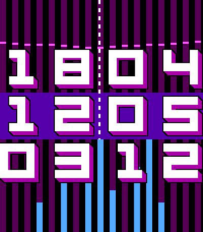

- **Digits:** date (day, month), the time in its bar, today's low and high. Below zero gets a minus: `-6`
- **Columns:** one per hour, 04:00 on the left, 20:00 on the right
- **Blue:** rain in that hour. Reaches the time bar? That's 1 mm/h — umbrella time
- **Pink dashes:** air pressure, one per hour, 985 hPa at the bottom, 1040 hPa at the top. Dashes going down, weather going down
- **Dotted line:** now. It walks through the day from left to right

Everything is optional, every color is yours (all 64 the Pebble has), and there's a separate look for the night.

<br clear="right">

## Any weather

The default look on six different days:

<p>
  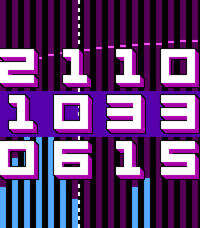
  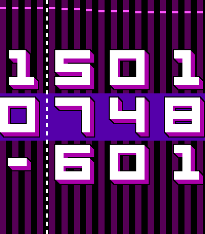
  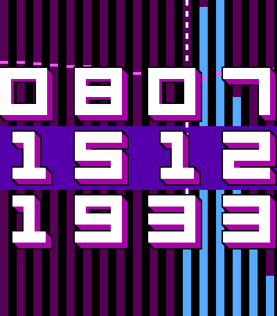
</p>
<p>
  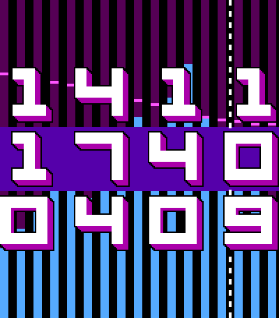
  
  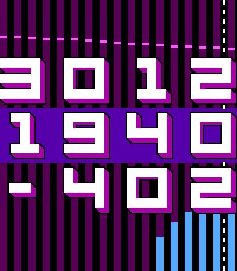
</p>

*Autumn front, pressure climbing · frosty high, −6 to 1 °C · 33 °C and a thunderstorm at four ·
a gale with pressure in free fall · April showers · a drizzly winter evening.*

## Stock presets

Eight looks built in, six of them with a night look of their own. Load one for the day, for the night, or both.

<p>
  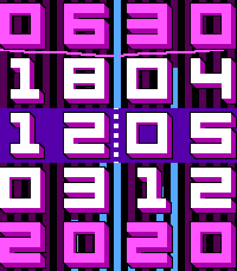
  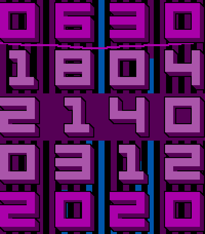
  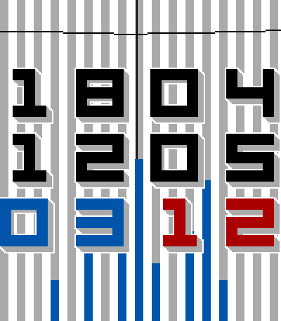
  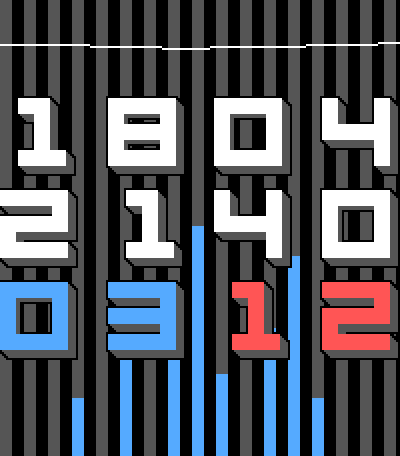
</p>
<p>
  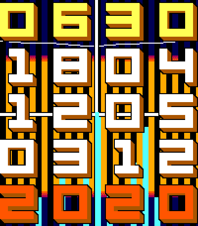
  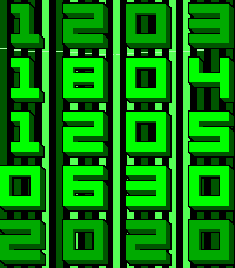
  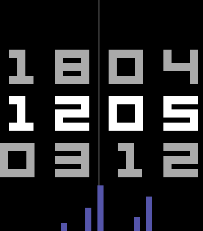
</p>
<p>
  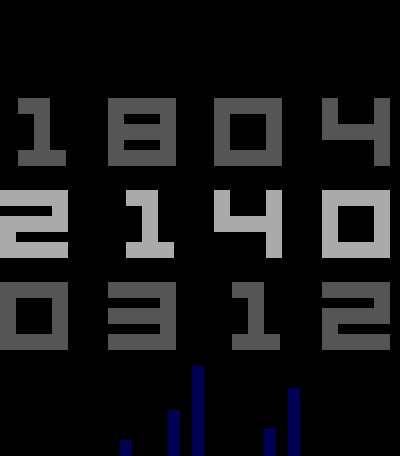
  
  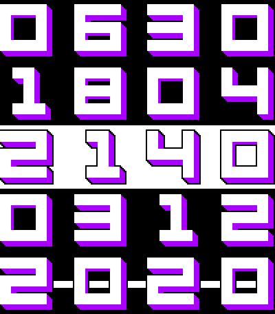
</p>
<p>
  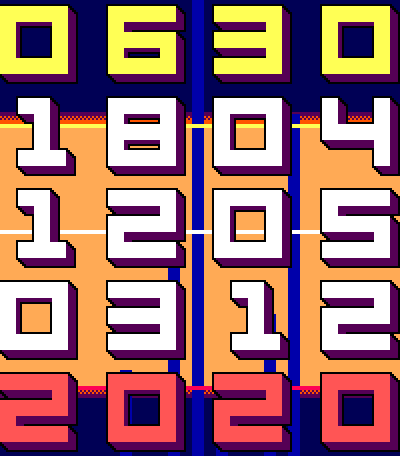
  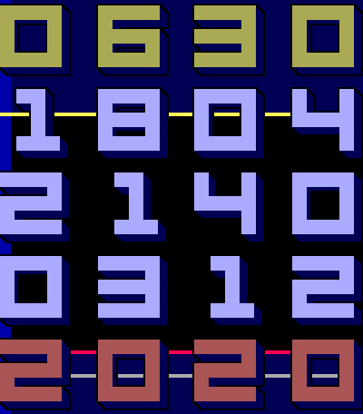
  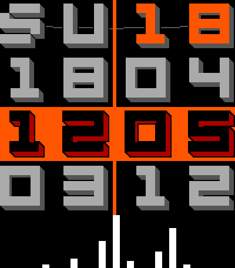
  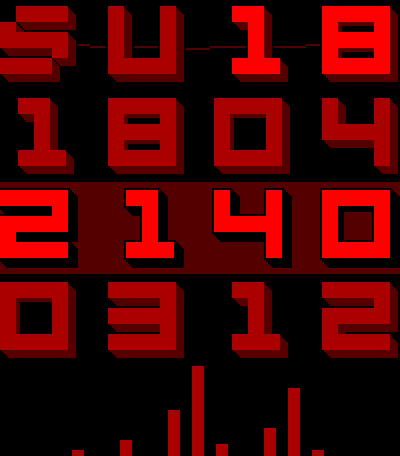
</p>

| Preset | The idea |
| --- | --- |
| **Neon** | The default, turned up: sunrise on top, sunset at the bottom, a smooth pressure line. Dims to purple at night |
| **Paper** | Black on white like a printout, blue low, red high. Turns itself inside out at night |
| **Sundial** | The sky as background — night, a twilight gradient, day — with the time lines as a framed cross |
| **Terminal** | Green phosphor, all the way. Rows rearranged: high and low on top, sunrise and sunset below |
| **Minimal** | As little as it gets: no columns, no pressure, rain as a thin strip at the bottom. At night everything steps down to grey |
| **Retro** | Seb's own: red and blue digits on a sunny orange sky, a fat 10 px cross for *now*, rain in bright full columns. At night it calms down — white digits, no sky, no rain |

| **Dusk** | The sky as background with stripes at sunrise and sunset; the time is just a white line across it. At night only the dark sky, with midnight in the middle |
| **Signal** | Grey on black and one loud accent: an orange time bar and line. At night it turns into red light |

*Neon Night, Paper Night, Minimal Night, Retro Night, Dusk Night and Signal Night are the night looks on their own, to put on any day you like.*

## Make it yours

### Five rows, eight blocks

The time sits in the middle — 24-hour, 12-hour or whatever the watch is set to. Rows 2 and 4 are always there,
rows 1 and 5 are optional. Each row has two blocks, and each block shows what you pick:

| From | Contents |
| --- | --- |
| the calendar | day, month, weekday (two letters), sunrise and sunset (hour, minute) |
| the weather | low, high, temperature now, rain chance now and for the next 12 hours, UV index now and today's max, wind, gusts |
| your wrist | battery, steps, heart rate |
| a whole block | temperature curve, pressure curve, pressure trend with hPa, your own text |
| symbols | two per block, smart or fixed |

Bars and colors belong to the position, so swapping contents never messes up the look. Numbers above 99 run into the
right block when it's empty (battery `100`, steps `8432`); otherwise they stop at 99, and steps count in thousands.

<p>
  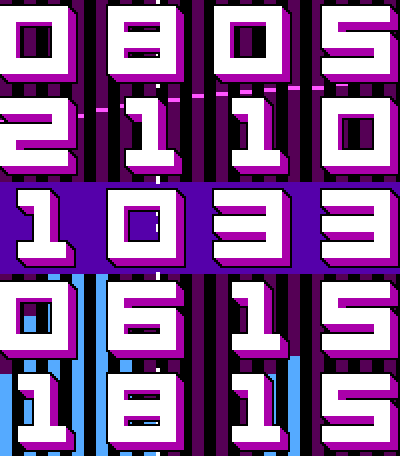
  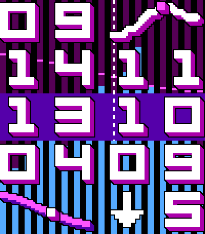
  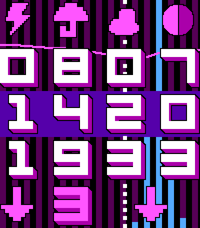
</p>

*Sunrise and sunset in rows 1 and 5 · temperature now, the day's temperature curve, pressure curve and a falling
arrow with −5 hPa · thunder warning, umbrella, clouds right now, half moon, pressure falling by 3 hPa.*

<p>
  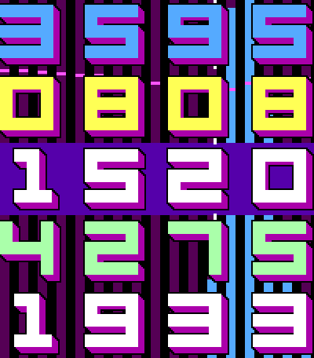
  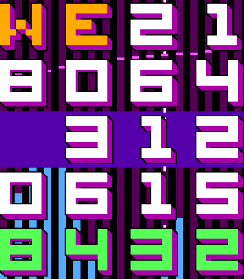
  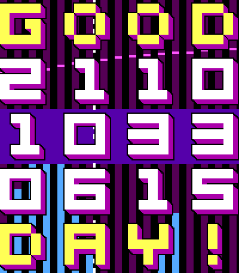
</p>

*Rain chance now and in the next 12 hours, UV now and max, wind and gusts in km/h, low and high · weekday and day,
battery and heart rate, the 12-hour clock, steps across a whole row · your own text: one letter above every digit,
four per row, built from the same blocks as the digits.*

### Smart symbols

They only turn up when there's a reason — and leave the cell empty when there isn't.

| Symbol | Shows up when |
| --- | --- |
| Umbrella | rain or thunder this hour or in the next two |
| Warning | thunder or gusts from 65 km/h in the next 3 hours, frost in the next 12 (lightning, windsock, snowflake) |
| Weather now | sun or moon, clouds, fog, rain, snow, lightning — for the current hour |
| Moon phase | always; eight phases, worked out on the watch |
| Pressure trend | always; flat, slanted or steep, from the last 3 hours (optionally with the hPa) |
| Stale data | the last update is more than 3 hours old |
| Battery low | 20 % or less and not charging |
| Phone disconnected | the watch has lost the phone |

Or pick any of the 34 symbols to stay put — including eight happy ones:

<p>
  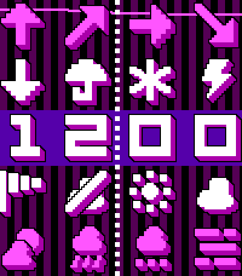
  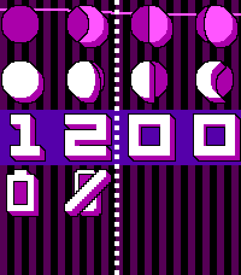
  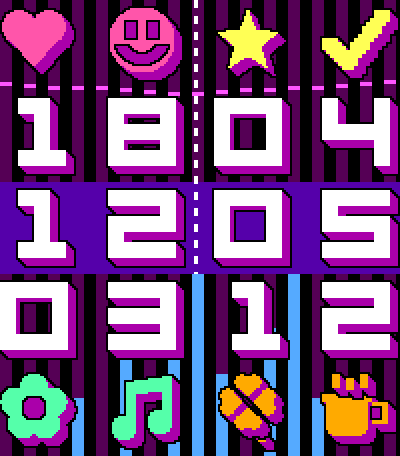
  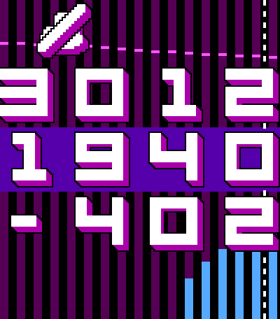
</p>

*Weather, moon and status symbols, four per row · heart, smiley, star, check mark, flower, music note, four-leaf clover,
coffee · no fresh data for a while: the crossed-out cloud.*

### One main color

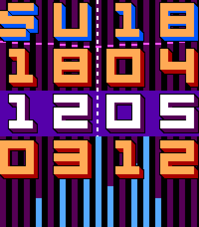

Every digit, letter and symbol takes the main color and the 3D edge — until you give a block, the time or a symbol
family its own color or edge. Here: orange digits with a red edge, blue edges in row 1, a white time.

<br clear="right">

### Rain

<p>
  
  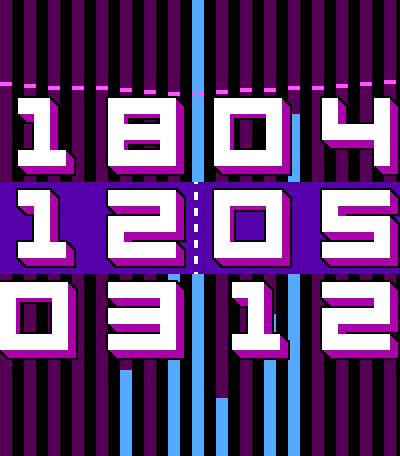
  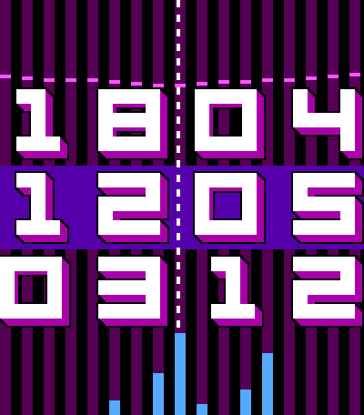
  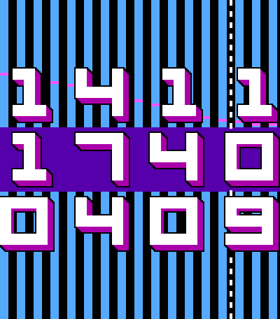
</p>

*Fixed scale (1 mm/h reaches the time bar) · daily max = full height · a slim strip at the bottom · full columns,
whatever the amount. A threshold keeps a few drops from filling a column.*

### Time axis

<p>
  
  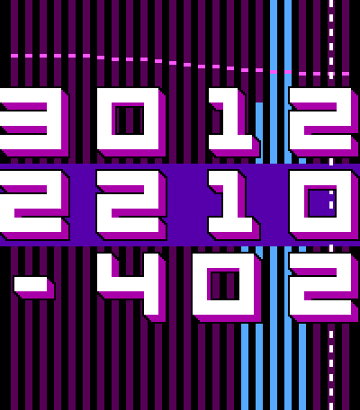
  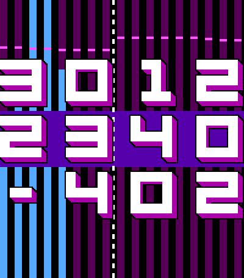
</p>

*04:00 to 20:00, the default · the whole day, 00:00 to 24:00 · the night, 16:00 to 08:00 with midnight in the middle —
handy for the night look. Columns, rain, pressure, the time line and the curves all follow.*

### Pressure, time lines, sun

<p>
  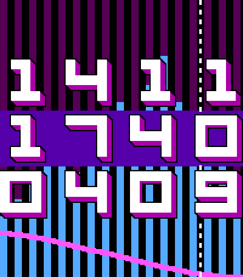
  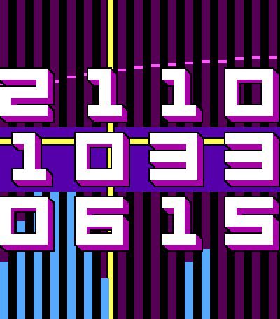
  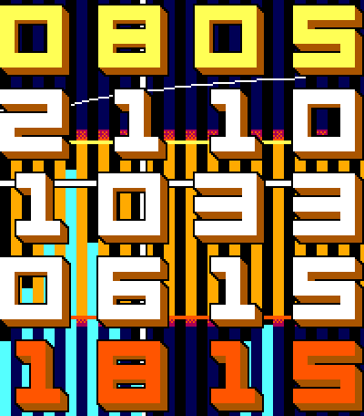
  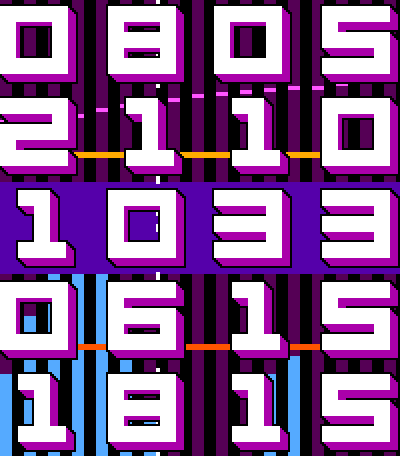
</p>

*Pressure as a thick line at the bottom · two time lines, up to 20 px, with a shared frame · the sun position as background ·
just two stripes at sunrise and sunset.*

The horizontal lines read the day **top to bottom**: midnight at the top, sunrise above sunset — right where the
sunrise digits in row 1 and the sunset digits in row 5 sit.

### Night mode

From sunset to sunrise a night theme takes over. It starts as a copy of the day and only keeps what you change —
dim the digits, swap the colors, show the moon instead of the date. **Save & show night for 30 s** puts it on the
watch right away, so you can judge it in daylight (and the day at night).

## Settings

Pebble app → Neonweather → settings. A live preview on top — with sample weather and a slider for the time, and a small
copy that follows you while you scroll — then English or German, day and night, the time axis and eight sections.
At night every section tells you how many things you changed.

<p>
  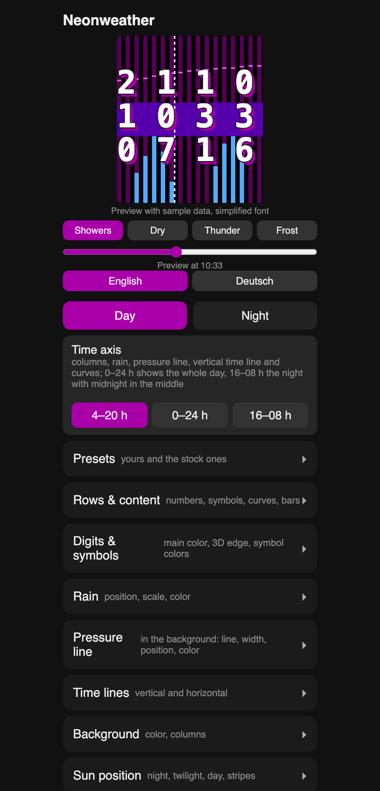
  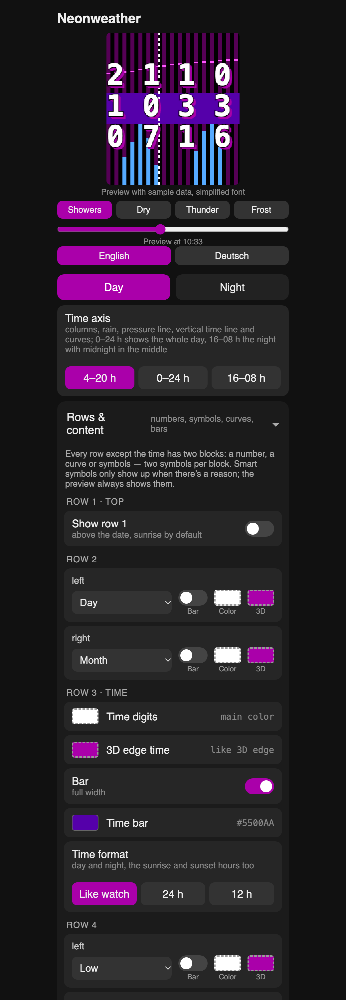
  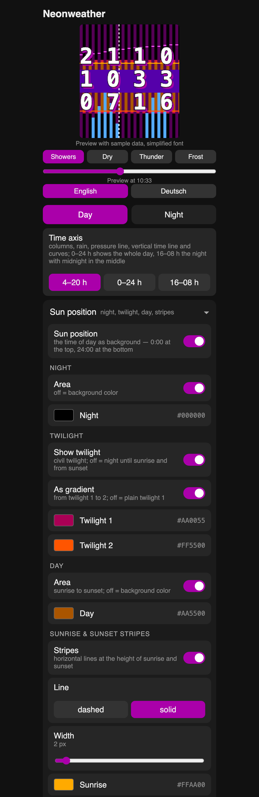
</p>
<p>
  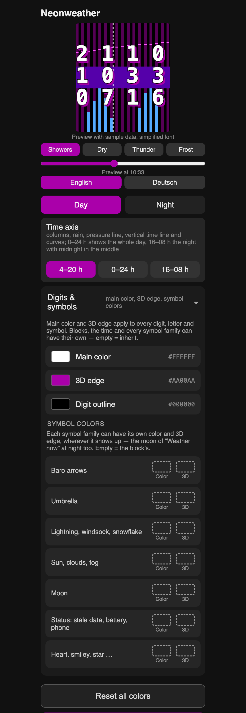
  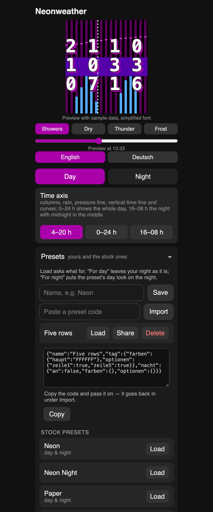
  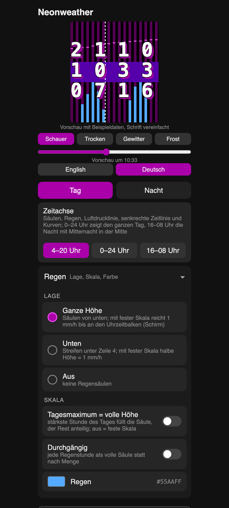
</p>

### Share a preset

Found a look you love? Presets → **Share** → **Copy**, and send the code to a friend. They paste it under **Import** —
done. Up to 20 presets of your own, each with its day and night.

## Install

1. Download `neonweather.pbw` from the [releases](../../releases)
2. Open it on your phone with the Pebble app — it installs on the watch
3. Allow location when asked: the weather is for where you are. Steps and heart rate need the health permission

Pebble Time 2 (emery) only.

## Under the hood

- Weather from [Open-Meteo](https://open-meteo.com), no account, no key: hourly rain, pressure, temperature, weather code,
  gusts, rain chance, UV index and wind, plus the day's low, high, sunrise and sunset. Twilight (sun at −6°) is worked out on the phone
- The watch asks at most once an hour. No network: again in 15 minutes. No phone: not at all — reconnecting asks right away
- Today and tomorrow (and yesterday evening, for the night axis) go to the watch in two packets of 236 and 144 bytes and
  stay there, so the night after midnight still has its weather
- Battery, steps and heart rate come from the watch itself; heart rate is the last reading, nothing extra is measured
- The settings page travels as a Base64 data URL, presets as differences from the default
- No text on the watch, so no language either. The settings page speaks English and German

## Building

Pebble SDK 4.x (`pebble` tool), Node.js for the tests. The comments are English; names in the code are German —
it started out as a private project.

```bash
tools/bauen.sh                      # build outside the source folder → dist/neonweather.pbw
tools/bauen.sh emu                  # build + emery emulator
node tools/test/logik_test.js       # weather packet, sun and twilight, colors, presets
node tools/test/seite_test.js       # settings page: sections, night, presets, sharing, German
node tools/test/text_vergleich.js   # free text: the preview places the same letters as the watch
tools/vorschau/rendern.sh out.png   # render main.c on the Mac, no SDK needed
python3 tools/screenshots.py docs/images   # every picture in this README
```

## Data and credits

- Weather: [Open-Meteo](https://open-meteo.com), CC BY 4.0. The test uses one saved response
- The weather in the screenshots is made up

## License

MIT, see [LICENSE](LICENSE).
